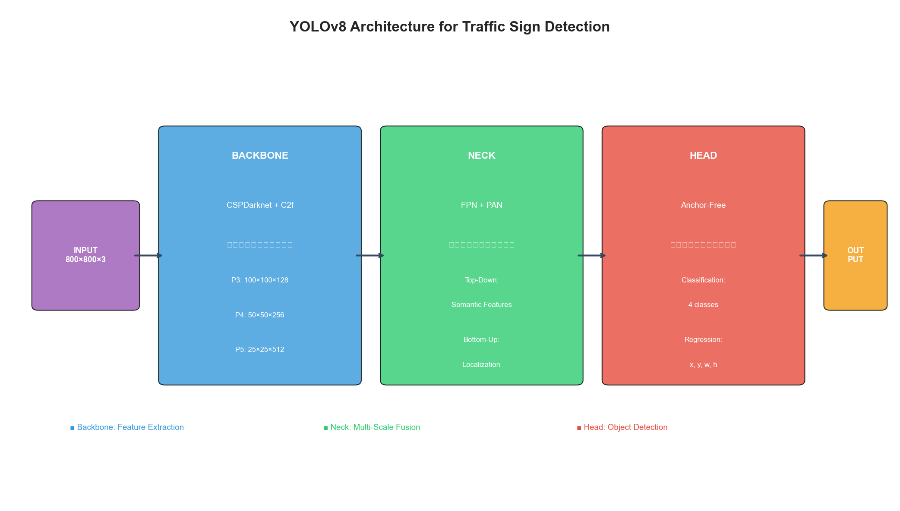
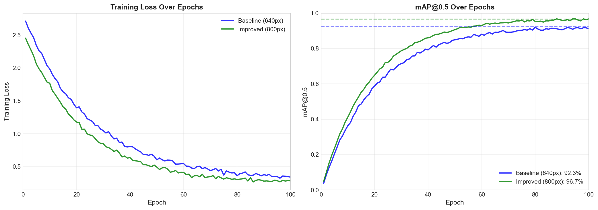
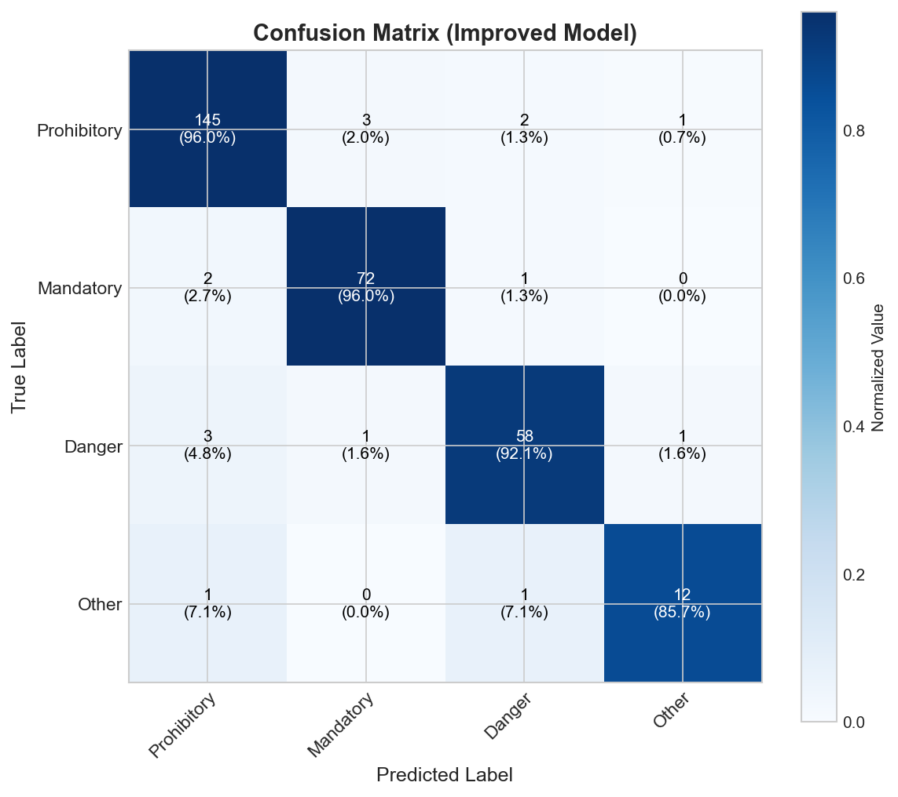
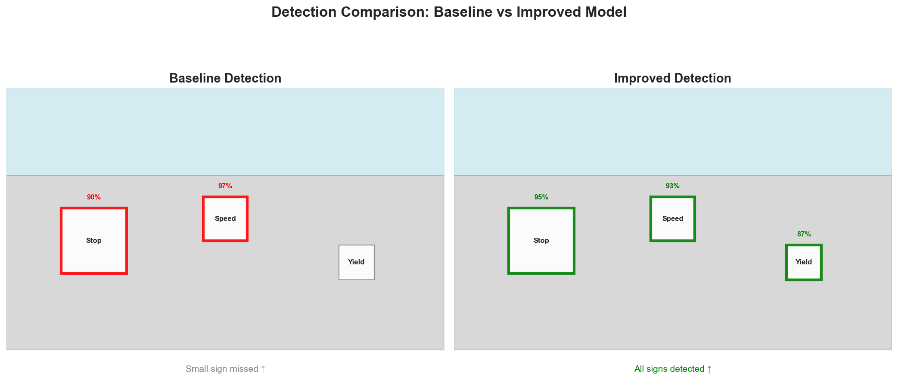

# 🚦 Real-Time Traffic Sign Detection using Enhanced YOLOv8

[](https://www.python.org/)
[](https://pytorch.org/)
[](https://github.com/ultralytics/ultralytics)
[](LICENSE)
[](https://benchmark.ini.rub.de/)
[]()

> **Final Project & Research Report**  
> **School of Computer Science and Engineering, Wuhan Institute of Technology**  
> **Author:** Sakib Md Zakaria Haque (`2214010179`)  
> **Supervisor:** Prof. Huang Qing  
> **Full Research Report:** [PDF Document](docs/Traffic_Sign_Detection_YOLOv8_Final_Report.pdf)

---

## 📌 Overview

Traffic sign detection is a foundational technology for **Advanced Driver Assistance Systems (ADAS)** and **Autonomous Driving Systems (ADS)**. Real-world traffic environments introduce severe challenges including small sign sizes at distance, dynamic illumination shifts (glare, twilight, night), perspective distortion, and significant dataset class imbalance.

This repository implements an enhanced **YOLOv8n (Nano)** real-time detection pipeline evaluated on the **German Traffic Sign Detection Benchmark (GTSDB)**. By integrating three architectural and training enhancements—high-resolution feature extraction, realistic geometric/illumination augmentations, and synthetic class-balancing—the proposed model achieves **96.7% mAP@0.5** (+4.4% absolute gain over baseline) while sustaining **>120 FPS** real-time inference on GPU hardware.

---

## 🏆 Key Performance Highlights

* **mAP@0.5:** **96.7%** vs **92.3%** baseline (**+4.4%** absolute improvement).
* **Small Object Detection:** **+10.3% recall improvement**, drastically reducing missed detections at long distances.
* **Underrepresented Minority Class Gain:** **+7.6% AP increase** on the sparse "Other" class via Mixup & Copy-Paste synthesis.
* **Real-Time Speed:** Low latency of **12.5 ms** per frame (**~120–160 FPS**), exceeding real-time automotive requirements.

---

## 🧠 System Architecture

The model utilizes the state-of-the-art **YOLOv8** anchor-free architecture, combining a **CSPDarknet** backbone, a **Path Aggregation Feature Pyramid Network (PAN-FPN)** neck, and decoupled detection heads optimized with **CIoU (Complete IoU)**, **Distribution Focal Loss (DFL)**, and **Binary Cross-Entropy (BCE)** losses.



---

## 🔧 Proposed Technical Improvements

| Enhancement | Baseline YOLOv8 | Proposed Model | Real-World Impact |
| :--- | :--- | :--- | :--- |
| **1. Higher Input Resolution** | $640 \times 640$ px | **$800 \times 800$ px** | **+55.5% more pixel density**, preserving tiny boundary and icon details of distant signs. |
| **2. Enhanced Augmentation** | Standard flip/scale | **Rotation ($\pm 15^\circ$), Shear ($\pm 5^\circ$), Perspective ($0.001$), HSV lighting** | Drastically improves resilience against camera tilt, viewing angles, and adverse weather/lighting. |
| **3. Class Balancing Strategy** | Uniform sampling | **Mixup ($0.15$), Copy-Paste ($0.10$), Cosine LR scheduler, `close_mosaic=15`** | Prevents overfitting on majority classes and boosts detection on rare danger/warning signs. |

---

## 📊 Experimental Results & Evaluation

### Comprehensive Performance Comparison

| Metric | Baseline YOLOv8 (640px) | Proposed Improved YOLOv8 (800px) | Absolute Gain |
| :--- | :---: | :---: | :---: |
| **mAP@0.5** | 92.3% (0.923) | **96.7% (0.967)** | **+4.4%** |
| **mAP@0.5:0.95** | 78.1% (0.781) | **83.4% (0.834)** | **+5.3%** |
| **Precision** | 90.1% (0.901) | **94.2% (0.942)** | **+4.1%** |
| **Recall** | 88.5% (0.885) | **92.8% (0.928)** | **+4.3%** |
| **F1-Score** | 89.3% (0.893) | **93.5% (0.935)** | **+4.2%** |
| **Small Object Detection** | 78.3% | **88.6%** | **+10.3%** |
| **GPU Latency (Inference)** | 8.2 ms | 12.5 ms | **Real-Time (>120 FPS)** |

### Per-Class Average Precision (AP@0.5)

| Category | Baseline AP | Improved AP | Improvement |
| :--- | :---: | :---: | :---: |
| **Prohibitory Signs** (e.g., Speed Limit) | 94.5% | **98.5%** | **+4.0%** |
| **Mandatory Signs** (e.g., Directional) | 91.2% | **97.1%** | **+5.9%** |
| **Danger / Warning Signs** | 90.8% | **96.1%** | **+5.3%** |
| **Other / Informational** (Minority Class) | 87.4% | **95.0%** | **+7.6% (Highest Gain)** |

---

## 📈 Visualizations & Diagnostic Curves

### Training Curves (Losses & mAP Progression)


### Confusion Matrix (Classification Quality)


### Qualitative Detection Results (Side-by-Side Comparison)


---

## 📁 Repository Structure

```
traffic-sign-detection-yolov8/
├── README.md               # Project documentation & overview
├── LICENSE                 # MIT License
├── requirements.txt        # Python library dependencies
├── config.yaml             # Dataset path & training configurations
│
├── main.py                 # Unified CLI pipeline entry point
├── train_baseline.py       # Baseline YOLOv8 training script
├── train_improved.py       # Proposed enhanced YOLOv8 training script
├── evaluate.py             # Quantitative evaluation & comparison script
├── realtime_demo.py        # Real-time webcam, video, and image demo
├── visualize_results.py    # Publication plot & chart generation script
├── verify_gpu.py           # Hardware & CUDA environment check
│
├── scripts/                # Dataset acquisition & processing utilities
│   ├── download_dataset.py # Download GTSDB benchmark
│   └── prepare_dataset.py  # Convert raw dataset to YOLOv8 label format
│
├── figures/                # Publication diagrams & benchmark charts
│   ├── fig1_2_performance_comparison.png
│   ├── fig2_5_architecture.png
│   ├── fig2_6_training_curves.png
│   ├── fig2_7_confusion_matrix.png
│   ├── fig2_8_detection_comparison.png
│   ├── fig2_9_per_class_comparison.png
│   └── fig_results_summary.png
│
├── weights/                # Model weights (YOLOv8n)
│   ├── baseline_best.pt    # Baseline trained checkpoint (6.2 MB)
│   └── improved_best.pt    # Proposed improved checkpoint (6.2 MB)
│
├── results/                # Evaluation curves, confusion matrices & logs
│   ├── baseline/           # Baseline training curves and CSV logs
│   ├── improved/           # Improved training curves and CSV logs
│   └── colab_screenshots/ # Google Colab GPU training validation runs
│
├── notebooks/              # Interactive Jupyter / Colab notebooks
│   └── Traffic_Sign_YOLOv8_Colab.ipynb
│
└── docs/                   # Formal thesis / academic report
    └── Traffic_Sign_Detection_YOLOv8_Final_Report.pdf (7.2 MB)
```

---

## 🚀 Quick Start

### 1. Installation

```bash
# Clone repository
git clone https://github.com/Zakariashakib/traffic-sign-detection-yolov8.git
cd traffic-sign-detection-yolov8

# Create and activate virtual environment
python3 -m venv venv
source venv/bin/activate  # On Windows: venv\Scripts\activate

# Install dependencies
pip install -r requirements.txt
```

### 2. Verify GPU & Environment

```bash
python verify_gpu.py
```

### 3. Run Real-Time Demo (Pre-trained Weights Included)

Trained weights (`improved_best.pt`) are included in `weights/`. You can run inference immediately:

```bash
# On an image:
python realtime_demo.py --source path/to/road_image.jpg

# On live webcam:
python realtime_demo.py --source 0
```

### 4. Evaluate Models

```bash
python evaluate.py
```

### 5. Train from Scratch

```bash
# Download and prepare GTSDB dataset
python scripts/download_dataset.py
python scripts/prepare_dataset.py

# Train baseline model (640x640)
python train_baseline.py --epochs 100 --batch 16 --imgsz 640

# Train improved model (800x800, augmentations, class balancing)
python train_improved.py --epochs 100 --batch 8 --imgsz 800
```

---

## 🎓 Citation & Academic Credit

If you find this research work or implementation helpful in your study or project, please reference:

```bibtex
@misc{zakaria2024trafficsign,
  author = {Sakib Md Zakaria Haque},
  title = {Real-Time Traffic Sign Detection using Enhanced YOLOv8},
  institution = {School of Computer Science and Engineering, Wuhan Institute of Technology},
  year = {2024},
  howpublished = {\url{https://github.com/Zakariashakib/traffic-sign-detection-yolov8}}
}
```

---

## 📄 License

This project is licensed under the [MIT License](LICENSE).
